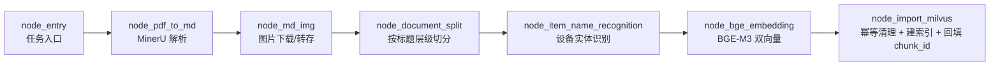
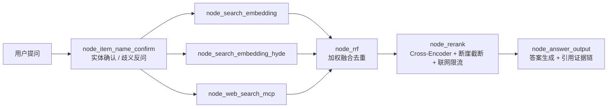

# 掌柜智库 · 技术资料 RAG 问答平台

面向设备 / 产品技术资料查询场景的 RAG 智能问答平台。解决人工翻手册慢、资料分散、答案无法溯源的问题：把 PDF / Markdown 技术文档解析入库，用混合向量检索 + 联网检索回答提问，并给出可点击溯源的引用证据链。

## 功能概览

- **文档导入**：支持 PDF / Markdown 批量上传，MinerU 解析 PDF（含表格、图片），图片自动下载并转存 MinIO。
- **语义切分**：按 Markdown 标题（`#` / `##` / `###`）切分为章节并保留父标题，超长章节再按「段落 → 句子」二次切分，过短章节按同父标题合并，减少碎片化。
- **双向量混合检索**：BGE-M3 稠密 + 稀疏双向量写入 Milvus，兼顾语义匹配与关键词精确命中。
- **三路并发召回**：向量检索、HyDE 假设性答案检索、MCP 联网搜索并行执行。
- **融合与精排**：RRF 加权融合去重 → Cross-Encoder 精排 → 断崖检测动态 Top-K 截断，避免固定截断引入噪声。
- **实体对齐**：基于 LLM 结构化抽取设备 / 商品名，歧义时主动反问，无匹配时拒答，减少错误检索与幻觉。
- **流式回答**：SSE 逐字输出，前端实时渲染，答案携带来源、切片 ID、标题与相关性得分。
- **多轮会话**：会话历史存 MongoDB，支持追问与历史回看。
- **链路评估**：内置 RAGAS 评估流程，可批量回归检索与生成质量并导出 bad case。

## 系统架构

系统拆成「存储」与「查询」两条 LangGraph 主流程，由两个独立的 FastAPI 服务对外提供。

**导入链路**



**查询链路**



## 关键设计

1. **幂等入库**：写入前按文件名清理该文档的旧切片（只按文档维度清理，不误删同商品名的其他文档），批量插入后回填 Milvus 自增主键 `chunk_id`，保证重复导入数据一致。
2. **双向量索引**：同一集合内同时建稠密向量与稀疏向量字段，检索时两路结果一起进入融合，关键词命中与语义命中都有保障。
3. **动态截断**：精排后不再固定取 Top-K，而是检测相邻得分是否出现绝对 / 相对断崖，在相关性骤降处截断，兼顾召回覆盖与上下文精度。
4. **联网限流**：联网结果按固定名额上限注入，并在排序前施加降权，避免网络内容挤占本地权威资料的排序位置。
5. **证据链**：检索结果统一携带 `source / chunk_id / title / score`，本地库与 MCP 结果走同一套结构，回答时映射为可溯源的引用卡片。
6. **实体确认**：查询前先判断问题指向的设备是否唯一，命中多个候选时反问澄清，避免在实体不确定的前提下继续检索。

## 技术栈

| 层次 | 选型 |
| --- | --- |
| 后端框架 | FastAPI + Uvicorn |
| 编排 | LangGraph、LangChain |
| 向量库 | Milvus（稠密 + 稀疏双向量，COSINE） |
| 词向量 / 精排 | BGE-M3、bge-reranker-large（Cross-Encoder） |
| 文档解析 | MinerU（PDF → Markdown）、Markdown 图片处理 |
| 关系 / 文档存储 | MongoDB（会话历史与切片元数据） |
| 对象存储 | MinIO（原始文件、文档图片） |
| 大模型 | DashScope（qwen-flash、qwen3-vl-flash），MCP WebSearch 联网 |
| 前端 | 原生 HTML / CSS / JavaScript + SSE |
| 评估 | RAGAS |
| 工程 | uv、Python 3.11+ |

## 目录结构

```text
knowledge_base/
├── config/                     # Milvus / MongoDB / MinIO / BGE / MinerU / MCP 配置
├── processor/
│   ├── import_processor/       # 导入侧 LangGraph（节点 + 状态 + 配置）
│   └── query_processor/        # 查询侧 LangGraph（节点 + 状态 + Prompt）
├── web/
│   ├── api/                    # import_service.py(8000) / query_service.py(8001)
│   └── page/                   # import.html / chat.html
├── utils/                      # milvus、minio、mongo 历史、embedding、reranker、SSE、任务状态
├── tool/                       # 日志等基础设施
├── scripts/                    # reset_kb（清库）、pdf_to_md_local（本地转换）、mineru_probe（探针）
├── eval/                       # RAGAS 评估：造数、运行、bad case 导出
├── test/                       # 单元测试（商品名归一化等）
├── runtime/                    # 运行时状态（已 gitignore）
└── temp-files/                 # 解析中间产物（已 gitignore）
```

## 快速开始

**1. 准备依赖服务**

- Milvus（默认 `http://localhost:19530`）
- MongoDB（默认 `mongodb://localhost:27017`）
- MinIO（默认 `localhost:9000`）
- 阿里云百炼 DashScope API Key（LLM 与 MCP 联网检索）
- 本地 BGE-M3 与 bge-reranker-large 模型文件

**2. 安装依赖**

```bash
uv sync
```

**3. 配置环境变量**

```bash
cp .env.example .env
# 按实际环境修改 API Key、存储地址与模型路径
```

> 无 GPU 的机器需要把 `BGE_DEVICE`、`BGE_RERANKER_DEVICE` 改为 `cpu`，并把 `BGE_FP16` / `BGE_RERANKER_FP16` 置为 `0`，否则启动时会报设备错误。

**4. 启动服务**

```bash
# 导入服务（上传与入库）
uv run python -m web.api.import_service     # http://127.0.0.1:8000/import.html

# 查询服务（问答与流式输出）
uv run python -m web.api.query_service      # http://127.0.0.1:8001/chat.html
```

两个服务分开部署，导入时的重任务不会阻塞线上问答。

## 接口一览

| 服务 | 端口 | 接口 | 说明 |
| --- | --- | --- | --- |
| 导入 | 8000 | `POST /upload` | 多文件批量上传，触发后台导入流程 |
| 导入 | 8000 | `GET /status/{task_id}` | 查询单文件处理进度与全局状态 |
| 导入 | 8000 | `GET /import.html` | 导入管理页 |
| 查询 | 8001 | `POST /query` | 发起提问，返回 `session_id` |
| 查询 | 8001 | `GET /stream/{session_id}` | SSE 流式返回答案与引用 |
| 查询 | 8001 | `GET /history/{session_id}` | 会话历史 |
| 查询 | 8001 | `GET /health` | 健康检查 |

## 运维与评估

```bash
# 知识库体检：默认只看现状、不删除任何数据
uv run python -m scripts.reset_kb

# 确认后清空（Milvus 两张集合 + MinIO 文件 + MongoDB 会话历史）
uv run python -m scripts.reset_kb --yes

# RAGAS 回归评估（--limit 限制样本数，--threshold 调整 bad case 判定阈值）
uv run python -m eval.eval_main --limit 2
```

Windows 控制台若出现中文乱码，先执行 `chcp 65001` 再运行评估脚本。

## 说明

- `.env`、`temp-files/`、`runtime/`、`eval/output/` 已在 `.gitignore` 中排除，仓库内不包含任何密钥与运行数据。
- 仓库未附带示例文档与截图，导入任意设备手册类 PDF 即可跑通全链路。
